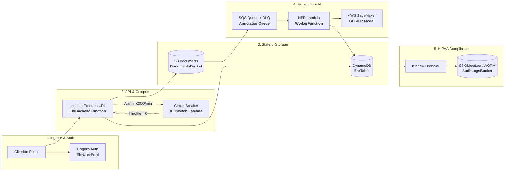
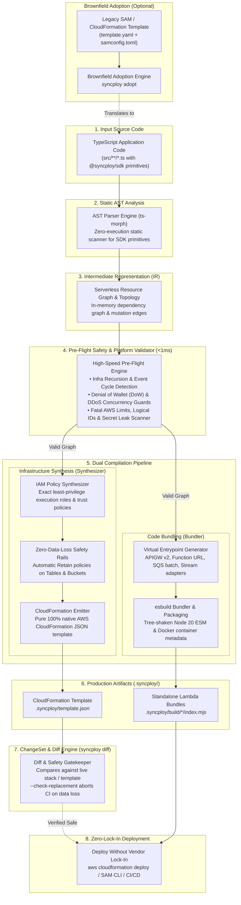

# ⚡ Syncploy

[](https://www.npmjs.com/package/@syncploy/sdk)
[](LICENSE)
[](https://github.com/harsh-vardhhan/syncploy/actions/workflows/ci.yml)
[](https://ehr-backend-frontend.vercel.app/)

> **The Terraform for AWS Serverless.**  
> Infrastructure-from-Code (IfC) compiler and runtime SDK for TypeScript.  
> Synthesize 1:1 AWS CloudFormation with zero YAML, zero state files, and zero data-loss replacements.

```bash
bun add @syncploy/sdk
# or
npm install @syncploy/sdk
```

---

## 🏥 Real-World Showcase: EHR Annotation Platform Migration

Syncploy is proven in live clinical healthcare infrastructure. The **[EHR Annotation Platform](https://ehr-backend-frontend.vercel.app/)** ([GitHub: harsh-vardhhan/EHR-backend](https://github.com/harsh-vardhhan/EHR-backend))—a HIPAA-compliant Electronic Health Record clinical extraction and OMOP Common Data Model lakehouse—migrated from a **600+ line legacy AWS SAM template** to Syncploy with **zero downtime, zero stateful replacements, and zero data loss**.

### 📊 Verified Migration Metrics

| Scale | Data Safety | Ergonomics | Performance |
| :---: | :---: | :---: | :---: |
| **11 Services** | **0 Replaced** | **45% Less Code** | **<50ms** |
| DynamoDB, S3, SQS, SNS, Firehose, Cognito, SageMaker, EventBridge, IAM, CloudWatch, Lambda | 100% preservation of DynamoDB tables & S3 ObjectLock compliance buckets | 600+ lines of brittle SAM YAML macros collapsed into ~300 lines of TypeScript | Sub-50ms compute latency via Bun/Elysia container with direct Function URL ingress |

### 🌐 Live Production Verification

* **Live Web Portal**: [`https://ehr-backend-frontend.vercel.app/`](https://ehr-backend-frontend.vercel.app/)
* **Active Lambda Ingress**: [`https://ofxtuegfgi6kqg4wfzfyuqu6be0mubmk.lambda-url.ap-south-1.on.aws/`](https://ofxtuegfgi6kqg4wfzfyuqu6be0mubmk.lambda-url.ap-south-1.on.aws/)
* **Verified Endpoints**:
  * `GET /` &rarr; `HTTP 200 OK` (`{"status":"ok","framework":"elysia"}`)
  * `GET /documents` &rarr; `HTTP 200 OK` (retrieves clinical encounters from DynamoDB `EhrTable`)
  * `GET /documents/doc-001` &rarr; `HTTP 200 OK` (retrieves medical text, 10 named clinical entities, and relationship graph)

### 🏗️ Live Cloud Architecture Flowchart



---

## 💡 How It Works: TypeScript to CloudFormation Synthesis

Instead of maintaining separate YAML/HCL files and runtime glue, you declare serverless infrastructure directly in TypeScript:

```typescript
// infrastructure.ts
import { Auth, api, Table, Queue } from "@syncploy/sdk";

// 1. Production-ready Cognito authentication with enterprise defaults
export const auth = new Auth("ehr", {
  logicalId: "EhrUserPool",
  adminOnly: true,              // Blocks unapproved self-signups
  signInMethod: "email",
  passwordPolicy: { minLength: 12 },
  client: { preventUserExistenceErrors: true },
});

// 2. DynamoDB Single-Table with Secondary Index
export const table = new Table("ehr", {
  logicalId: "EhrTable",
  partitionKey: { name: "PK", type: "string" },
  sortKey: { name: "SK", type: "string" },
  indexes: {
    GSI1: { partitionKey: "GSI1PK", sortKey: "GSI1SK", projection: "ALL" },
  },
});

// 3. High-performance API using Lambda Function URLs ($0 routing overhead)
export const backendApi = api(
  {
    path: "/",
    ingress: "function-url",
    concurrency: 50, // Prevents Denial-of-Wallet runaway
    cors: { allowOrigins: ["https://my-portal.com"] },
  },
  async (req) => {
    // COGNITO_USER_POOL_ID and TABLE_NAME are auto-injected by compiler!
    return Response.json({ status: "ok", poolId: auth.userPoolId });
  }
);
```

When you run `syncploy build`, the compiler analyzes the AST and deterministically outputs 1:1 native AWS CloudFormation:

```yaml
# .syncploy/template.json (Synthesized Output)
Resources:
  EhrUserPool:
    Type: AWS::Cognito::UserPool
    Properties:
      UserPoolName: !Sub "${AWS::StackName}-ehr"
      AdminCreateUserConfig:
        AllowAdminCreateUserOnly: true
      Policies:
        PasswordPolicy:
          MinimumLength: 12
          RequireUppercase: true
          RequireNumbers: true

  EhrTable:
    Type: AWS::DynamoDB::Table
    DeletionPolicy: Retain
    UpdateReplacePolicy: Retain
    Properties:
      BillingMode: PAY_PER_REQUEST
      AttributeDefinitions:
        - AttributeName: PK
          AttributeType: S
        - AttributeName: SK
          AttributeType: S
      KeySchema:
        - AttributeName: PK
          KeyType: HASH
        - AttributeName: SK
          KeyType: RANGE

  BackendFunction:
    Type: AWS::Lambda::Function
    Properties:
      Environment:
        Variables:
          COGNITO_USER_POOL_ID: !Ref EhrUserPool
          EHR_TABLE_NAME: !Ref EhrTable
```

---

## 🛡️ Core Architectural Capabilities

### 1. Compile-Time Recursion Shield (<1ms)
Static AST analysis traces database mutations and message dispatches across your handlers. Detects infinite event cycles before code reaches AWS:
- Direct loops: `Table -> Stream Consumer -> Table.put`
- Queue loops: `Queue -> Consumer -> Queue.send`
- Multi-hop cycles: `Bucket -> EventBridge -> Queue -> Consumer -> Bucket.upload`

### 2. Zero-Replacement Brownfield Diff Engine (`syncploy diff`)
CloudFormation updates can silently destroy and recreate stateful resources when properties drift. Syncploy's pre-flight diff engine matches against live AWS stacks and aborts CI with `--check-replacement` if any database or bucket would be destroyed.

### 3. Least-Privilege IAM Policy Generator (`syncploy policy`)
Eliminates trial-and-error IAM authoring and wildcard `*` permissions. Syncploy inspects your AST and generates precise GitHub Actions deployment policies (`deploy-policy.json`) scoped down to exact stack resource ARNs.

### 4. ElectroDB First-Class Integration
Natively understands ElectroDB entities. Infers Single-Table primary keys, composite sort keys, and unions all Global Secondary Indexes (GSIs) across entity definitions automatically without redundant table declarations.

### 5. Denial-of-Wallet (DoW) & Concurrency Audits
- Validates that SQS queue `visibilityTimeout` is $\ge 6\times$ consumer timeout to halt retry duplicate execution storms.
- Warns when public Function URLs or stream consumers lack concurrency caps.
- Enforces Dead Letter Queue (DLQ) redrive policies on all active consumer queues.

### 6. Container & ESM Packaging
Compile handlers into treeshaken, minified Node 20 ESM bundles via `esbuild`, or build native Alpine Docker container images via Bun and the AWS Lambda Web Adapter.

---

## ⚖️ How Syncploy Compares

| Architectural Capability | Syncploy | AWS CDK | SST (Ion) | Serverless Framework | Encore (Go) |
| :--- | :---: | :---: | :---: | :---: | :---: |
| **Pure AWS Serverless Focus** | **Yes** | Mixed | Mixed | Mixed | Mixed |
| **Compile-Time Recursion Shield** | **Yes (<1ms)** | No | No | No | No |
| **Zero-Replacement Brownfield Diff** | **Yes** | No | No | No | No |
| **Automatic IAM Deploy Policy Synthesis** | **Yes** | No | No | No | No |
| **1:1 Standard CloudFormation Export** | **Yes** | Yes | Pulumi/CFN | Yes | No |
| **TypeScript Native (No Go/Rust runtime required)** | **Yes** | Yes | Yes | Yes | No (Go required) |
| **Denial-of-Wallet Concurrency Audits** | **Yes** | No | No | No | No |
| **100% Ejection Freedom (Zero Vendor Lock-In)** | **Yes** | Yes | Vendor Cloud | Vendor Dashboard | Vendor Cloud |

---

## 🏗️ Compiler Architecture & Compilation Pipeline

Syncploy executes a deterministic, 8-stage compilation pipeline:



---

## ☁️ Supported Pure AWS Serverless Services

Syncploy exclusively targets services that **scale to zero**, require **zero VPC/server maintenance**, and operate over stateless IAM/HTTPS:

| Service Category | AWS Service | SDK Primitive | In-Code Configuration |
| :--- | :--- | :--- | :--- |
| **Compute** | **AWS Lambda** (Node 20 ESM & Docker Containers) | `api(...)`, `queue.consumer(...)`, `table.stream(...)`, `topic.subscribe(...)` | `memory`, `timeout`, `concurrency`, `container` (`dockerfile`, `context`, `imageUri`, `cmd`, `entrypoint`) |
| **HTTP Ingress (Unified)** | **API Gateway (HTTP API v2)** | `api({ ingress: "api-gateway" })` | `path`, `method`, `auth`, `cors` |
| **Direct Ingress (Streaming)** | **Lambda Function URLs** | `api({ ingress: "function-url" })` | `timeout` up to 15m, native response streaming, $0 routing cost |
| **NoSQL Database** | **Amazon DynamoDB (On-Demand)** | `new Table("name", { ... })` | `partitionKey`, `sortKey`, `indexes` (GSIs), `stream`, `pointInTimeRecovery`, `retain` |
| **Database Streams** | **Amazon DynamoDB Streams** | `table.stream(...)` | `batchSize`, `startingPosition`, `enabled`, partial batch failure reporting |
| **Object Storage** | **Amazon S3** | `new Bucket("name", { ... })` | `versioned`, `eventBridge`, `publicAccessBlock`, `objectLock` (COMPLIANCE/GOVERNANCE), `retain` |
| **Data Streaming** | **Amazon Data Firehose** | `new DeliveryStream("name", { ... })` | `destination`, `bufferingInterval`, `bufferingSize`, `compression`, `prefix`, `errorPrefix` |
| **Message Queues** | **Amazon SQS** | `new Queue("name", { ... })` | `visibilityTimeout`, `deadLetterQueue` (auto-DLQ generation), `fifo` |
| **Pub/Sub Messaging** | **Amazon SNS** | `new Topic("name", { ... })`, `topic.subscribe(...)` | `fifo`, IAM subscriptions |
| **Authentication** | **Amazon Cognito** | `new Auth("name", { ... })` | `adminOnly`, `signInMethod`, `passwordPolicy`, `client` (SRP invariants) |
| **Monitoring & Alarms** | **Amazon CloudWatch** | `new Alarm("name", { ... })` | `threshold`, `evaluationPeriods`, `comparison`, `metrics`, `alarmActions` (SNS topics) |
| **Event Routing** | **Amazon EventBridge** | `bucket.on("objectCreated", queue)` | Event pattern filters, S3 prefix/suffix routing |
| **Secrets & Config** | **AWS Secrets Manager / SSM** | `new Secret("KEY")` | Type-safe environment injection |
| **Access Control** | **AWS IAM** | *Automatic* | Static inference generates exact least-privilege policies |

---

## 🔒 Pre-Flight AWS Platform Validator (<1ms)

The compiler catches fatal platform constraints and Denial-of-Wallet risks in under 1 millisecond:

* **Infra Recursion & Cycle Detection (Fatal)**: Traces directed event and mutation graphs using DFS cycle detection to catch infinite self-amplifying loops (`Table -> Stream -> Table.put`, `Queue -> Consumer -> Queue.send`, `Bucket -> EventBridge -> Queue -> Consumer -> Bucket.upload`).
* **Denial of Wallet (DoW) & DDoS Guards**:
  * **SQS Timeout Mismatch**: Enforces that queue `visibilityTimeout` is $\ge 6\times$ consumer `timeout` to eliminate duplicate delivery storms.
  * **Missing DLQ / Retry Storms**: Warns when active queue consumers lack a `deadLetterQueue`, preventing poison-pill message loops.
  * **Uncapped Public Concurrency**: Warns when public Function URLs lack `concurrency` caps, preventing DDoS billing attacks.
  * **DynamoDB Shard Surge Guard**: Warns on unthrottled stream consumers to prevent shard-split cost runaway.
* **CloudFormation Logical IDs**: Strictly alphanumeric (`^[A-Za-z0-9]+$`). Catches fatal syntax errors like `logicalId: "ehr-table"`.
* **Lambda Limits**: Validates memory (128 MB to 10,240 MB) and timeout limits (1s to 900s / 15m). Catches illegal sizes like `64MB` or `20m`.
* **S3 Bucket Naming**: Enforces strict RFC 1123 DNS compliance (lowercase only, no underscores, 3–63 chars).
* **FIFO Messaging**: Enforces the mandatory `.fifo` suffix on all FIFO queues and topics.
* **DynamoDB Schema**: Validates primary key and sort key attribute types and enforces the 20 GSI hard limit.
* **Firehose Boundaries**: Validates buffering intervals (60s to 900s) and buffer sizes (1 MB to 128 MB).
* **CORS Protocol Validation**: Detects origins missing protocol schemes (instructs `http://localhost:3000` instead of `localhost:3000`).
* **IAM Policy Validation**: Enforces `service:Action` format and warns on overly permissive wildcards.
* **Secret Leak Scanner**: Detects committed plaintext API keys and secrets in environment variables (`sk-proj-...`, `AKIA...`, `ghp_...`, PEM private keys).

---

## 🔍 ChangeSet & Diff Engine (`syncploy diff`)

Compare synthesized infrastructure against an existing SAM/CloudFormation template or a live deployed AWS stack:

```bash
# Diff against a local SAM/CloudFormation template
syncploy diff --against template.yaml

# Diff against a live AWS CloudFormation stack (creates a temporary ChangeSet)
syncploy diff --stack-name my-production-stack

# Enforce safety gatekeeper in CI/CD (aborts if stateful resources would be replaced)
syncploy diff --against template.yaml --check-replacement
```

### Visual Diff Output

```text
Infrastructure Diff Preview:

  ~ [UPDATE] EhrBackendFunction (AWS::Serverless::Function -> AWS::Lambda::Function)
      • Migrated from Serverless macro to pure CloudFormation function
  ~ [UPDATE] EhrAnnotationQueue (AWS::SQS::Queue)
      • ~ VisibilityTimeout (120 -> 180)
  ! [REPLACE] EhrTable (AWS::DynamoDB::Table)
      ⚠ DANGER: Resource will be DESTROYED and RECREATED!
      • TableName changed ("prod-ehr-table" -> "my-stack-ehr")

Diff Summary:
  + 0 to create | ~ 2 to update | ! 1 to replace | - 0 to delete | 5 unchanged

❌ DEPLOYMENT BLOCKED: Stateful resource replacement detected on: EhrTable (AWS::DynamoDB::Table)
   Replacing stateful resources will cause DATA LOSS because the existing resource is destroyed.
   To bypass this safety gatekeeper, pass: --allow-stateful-replacement
```

---

## 🔄 Brownfield Adoption (`syncploy adopt`)

Migrate existing AWS SAM or CloudFormation projects into type-safe Syncploy TypeScript in seconds:

```bash
# Adopt a SAM template, resolving parameters from samconfig.toml
syncploy adopt ./template.yaml --config ./samconfig.toml --out src/infra.ts

# Or pass parameter overrides directly
syncploy adopt ./template.yaml --params EhrTableName=prod-ehr-table --out src/infra.ts
```

The adoption engine parses the template, resolves physical names and parameters, and outputs idiomatic TypeScript with exact `logicalId`s, primary keys, GSIs, streams, DLQs, alarms, and retention policies preserved.

---

## 🚀 Compiler CLI Reference

```text
Usage: syncploy [command] [options]

Commands:
  build [dir]                  Compile TypeScript backend into CloudFormation and Lambda bundles
  diff [dir] [options]         Compare synthesized infrastructure against a template or live AWS stack
  adopt <template> [options]   Automatically adopt an existing SAM/CloudFormation template into TypeScript
  policy [dir] [options]       Generate least-privilege IAM deployment policy for CI/CD runners

Diff Options:
  -a, --against <file>         Existing template file to diff against (e.g. template.yaml)
  -s, --stack-name <name>      AWS CloudFormation stack name for live ChangeSet diff
  --region <region>            AWS region for live ChangeSet diff
  --check-replacement          Abort and exit with error if any stateful resource would be replaced
  --allow-stateful-replacement Bypass the replacement safety check

Adopt Options:
  -c, --config <samconfig>     Path to samconfig.toml to extract parameter overrides
  -o, --out <file>             Output TypeScript file path (e.g. src/infra.ts)
  -p, --params <params...>     Inline parameter overrides (Key=Value)

Policy Options:
  -s, --stack-name <name>      CloudFormation stack name to scope IAM resource ARNs
  -r, --region <region>        AWS region (default: ap-south-1)
  -o, --out <file>             Output policy JSON path (default: deploy-policy.json)
```

### Zero-Lock-In Deployment

Syncploy compiles to vanilla AWS CloudFormation templates and tree-shaken bundles in `.syncploy/`. Deploy using standard AWS tooling:

```bash
# Using standard AWS CLI
aws cloudformation deploy \
  --template-file .syncploy/template.json \
  --stack-name my-serverless-app \
  --capabilities CAPABILITY_IAM CAPABILITY_NAMED_IAM

# Or using AWS SAM
sam deploy --template-file .syncploy/template.json
```

---

## 📄 License

MIT Licensed &bull; Open Source
