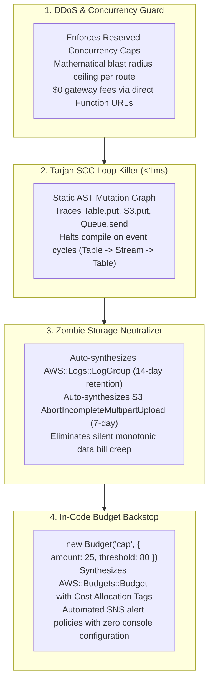

# ⚡ Syncploy

[](https://www.npmjs.com/package/@syncploy/sdk)
[](https://github.com/harsh-vardhhan/syncploy)
[](LICENSE)
[](https://github.com/harsh-vardhhan/syncploy/actions/workflows/ci.yml)
[](https://www.syncploy.com/llms.txt)
[-emerald)](https://ehr-backend-frontend.vercel.app/)

> **Build on AWS. Sleep Through the Night.**  
> The Zero-DoW (Denial of Wallet) Serverless Framework for TypeScript.  
> Statically eliminate infinite loops, uncapped DDoS bills, and silent storage leaks before your code ever touches the cloud.

---

### Stop Paying the PaaS Tax Out of Fear of AWS

Developers love serverless on AWS because it scales to zero and costs pennies. But millions of teams remain trapped paying the **10x–50x PaaS tax** on Vercel, Render, or Railway for one simple reason:

> *"I am terrified of waking up to a $40,000 credit card bill because a bot attacked my endpoint or a Lambda worker triggered an infinite database loop."*

**Syncploy is built from day one to eliminate that fear.**  

By pairing an ultra-lightweight TypeScript SDK with an AST compiler that runs in `<1ms`, Syncploy mathematically bounds your financial blast radius, detects event-driven recursion loops, and auto-synthesizes log and storage cleanups—compiling down to **100% native, vanilla AWS CloudFormation**.

```bash
bun add @syncploy/sdk
# or
npm install @syncploy/sdk
```

---

## 🧮 The Mathematical Blast Radius Formula

Traditional cloud architectures fail open: when traffic surges 10,000x under a DDoS bot attack, Lambda scales to 1,000+ unreserved parallel executions, racking up tens of thousands of dollars in hours.

With Syncploy, every public endpoint and event consumer is audited for concurrency caps. Because execution concurrency and memory are explicitly bounded, your **worst-case, 24/7 continuous monthly compute liability** is mathematically capped to exact dollars:

$$\text{Worst-Case Monthly Bill} = \text{Concurrency} \times \frac{\text{Memory MB}}{1024} \times 2,592,000\text{s} \times \$0.0000166667$$

*Example*: An endpoint configured with `concurrency: 5` and `memory: "256MB"` has a theoretical maximum 24/7 monthly liability of:

$$5 \times 0.25 \times 2,592,000 \times 0.0000166667 \approx \mathbf{\$54.00 / \text{month}}$$

Even if an attacker sends **1,000,000,000 requests**, Lambda will reject unthrottled invocations with `HTTP 429 Too Many Requests`. **Your bill cannot exceed the ceiling.**

---

## 🛡️ The 4 Layers of Denial-of-Wallet Immunity

Syncploy's pre-flight compiler enforces a comprehensive 4-layer shield across your architecture:



### 1. Concurrency Blast Radius Caps (`WARN_DOW_UNRESERVED_CONCURRENCY`)
Flags any public Function URL or API route without explicit `concurrency: <number>`. Enforces API Gateway stage token-bucket throttling (`rateLimit`, `burstLimit`) and stream shard concurrency caps.

### 2. Tarjan SCC Infinite Recursion Loop Killer (`ERR_RECURSIVE_LOOP`)
Traces all write mutations (`table.put`, `bucket.putText`, `queue.send`, `topic.publish`, HTTP `fetch` self-calls) across your handlers. Runs Tarjan's Strongly Connected Components algorithm in $O(V+E)$ linear time ($<1\text{ms}$). If an event loop exists (e.g. `Table -> Stream -> Table.put`), **compilation hard-aborts before anything touches AWS**.

### 3. Zombie Storage & Monotonic Leak Neutralizer
- **CloudWatch Logs**: AWS Lambda by default creates log groups set to *Never Expire*, accumulating gigabytes forever at \$0.03/GB-mo. Syncploy auto-synthesizes an explicit `AWS::Logs::LogGroup` with `RetentionInDays: 14` for every Lambda function.
- **S3 Multipart Uploads**: Orphaned multipart upload chunks from aborted or interrupted uploads linger indefinitely at standard S3 rates. Syncploy auto-injects an S3 `LifecycleConfiguration` rule (`AbortIncompleteMultipartUpload: { DaysAfterInitiation: 7 }`) on every bucket.

### 4. In-Code Budgets & Hard Alerts (`ERR_BUDGET_*`)
Declare cost guardrails directly in TypeScript:
```typescript
export const monthlyBudget = new Budget("monthlyBudget", {
  amount: 25,
  unit: "USD",
  threshold: 80, // Alert at 80% ($20.00)
  filterByStack: true, // Tag-scoped to this stack
  topic: alertTopic,
});
```
Syncploy synthesizes the `AWS::Budgets::Budget` resource, wires the `AWS::SNS::TopicPolicy` granting AWS Budgets publish permissions, and tags resources for Cost Allocation filtering.

---

## 🏥 Proven in Production: EHR Annotation Platform (\$0.42/mo)

Syncploy is not a theoretical prototype—it powers live, HIPAA-compliant clinical healthcare infrastructure. The **[EHR Annotation Platform](https://ehr-backend-frontend.vercel.app/)** ([GitHub: harsh-vardhhan/EHR-backend](https://github.com/harsh-vardhhan/EHR-backend)) migrated from a **600+ line legacy AWS SAM template** to Syncploy with **zero downtime, zero stateful replacements, and zero data loss**.

### 📊 Verified Production Metrics

| Live Architecture Scale | Stateful Safety | Codebase Reduction | Real Monthly Bill |
| :---: | :---: | :---: | :---: |
| **11 AWS Services** | **0 Replaced** | **45% Less Code** | **$0.42 / month** |
| DynamoDB, S3 ObjectLock, SQS, SNS, Firehose, Cognito, SageMaker, EventBridge, IAM, CloudWatch, Lambda | 100% preservation of DynamoDB tables & compliance S3 buckets | 600+ lines of brittle SAM YAML macros collapsed to ~300 lines of TypeScript | Complete clinical lakehouse running 24/7 with zero idle charges |

### 🌐 Live Endpoints
- **Live Clinician Portal**: [`https://ehr-backend-frontend.vercel.app/`](https://ehr-backend-frontend.vercel.app/)
- **Active Lambda Ingress**: [`https://ofxtuegfgi6kqg4wfzfyuqu6be0mubmk.lambda-url.ap-south-1.on.aws/`](https://ofxtuegfgi6kqg4wfzfyuqu6be0mubmk.lambda-url.ap-south-1.on.aws/)
- `GET /` &rarr; `HTTP 200 OK` (`{"status":"ok","framework":"elysia"}`)
- `GET /documents` &rarr; `HTTP 200 OK` (retrieves clinical encounters from DynamoDB `EhrTable`)

---

## ⚡ Quickstart: Pure TypeScript Architecture

Declare serverless infrastructure side-by-side with business logic in TypeScript:

```typescript
// app.ts
import { api, Table, Bucket, Queue, Topic, Budget } from "@syncploy/sdk";

// 1. Single-Table DynamoDB with On-Demand Billing & Continuous Backups
export const ehrTable = new Table("ehr", {
  partitionKey: { name: "PK", type: "string" },
  sortKey: { name: "SK", type: "string" },
  billingMode: "PAY_PER_REQUEST",
  stream: "NEW_IMAGE",
  pointInTimeRecovery: true,
});

// 2. S3 Bucket with Auto-Expiring Multipart Cleanup & EventBridge
export const docsBucket = new Bucket("documents", {
  eventBridge: true,
  publicAccessBlock: true,
});

// 3. SQS Queue with Working Dead-Letter Queue & 6x Visibility Math
export const jobsQueue = new Queue("jobs", {
  visibilityTimeout: "180s", // >= 6x consumer timeout (30s * 6 = 180s)
  deadLetterQueue: { maxReceiveCount: 3 },
});

// 4. DDoS-Guarded Public API ($0 Gateway Fee via Direct Function URL)
export const backendApi = api(
  {
    path: "/",
    ingress: "function-url",
    concurrency: 5, // Mathematically bounds max monthly spend to ~$54
    timeout: "30s",
    cors: { allowOrigins: ["https://my-app.com"] },
  },
  async (req) => {
    // Environment variables (EHR_TABLE_NAME, DOCUMENTS_BUCKET_NAME) are auto-injected!
    return Response.json({ status: "healthy" });
  }
);

// 5. In-Code Budget Guarantee
export const alerts = new Topic("alerts");
export const stackBudget = new Budget("budget", {
  amount: 25,
  threshold: 80,
  topic: alerts,
  filterByStack: true,
});
```

Compile into native AWS CloudFormation and bundled Lambda packages in seconds:

```bash
npx syncploy build
```

---

## ⚖️ The 3 Paths: Choose Your Reality

| Architectural Dimension | PaaS (Vercel / Render / Railway) | Raw AWS (CDK / SAM / Console) | **Syncploy (Zero-DoW Shield)** |
| :--- | :--- | :--- | :--- |
| **Monthly Baseline Spend** | \$20 – \$200/mo minimums + per-seat taxes | \$0.00 scale-to-zero | **\$0.00 true scale-to-zero** |
| **Bandwidth & Compute Markup** | 10x – 50x markup (\$0.15–\$0.40/GB bandwidth) | \$0.09/GB raw AWS pricing | **\$0.09/GB wholesale AWS (\$0 gateway fees)** |
| **Denial-of-Wallet (DDoS) Protection** | ❌ Surprise \$10k+ invoices with zero recourse | ❌ Unreserved Lambdas scale to 1,000+ instances | **✅ Mathematical concurrency bounds & blast radius caps** |
| **Infinite Event Recursion Loops** | ❌ None (runaway billing until manual shutoff) | ❌ None (`Table -> Stream -> Table` runs indefinitely) | **✅ Compile-time Tarjan SCC cycle block (&lt;1ms)** |
| **Monotonic Storage & Log Leaks** | ❌ Log retention locked behind higher tiers | ❌ Never-Expire logs & orphaned S3 parts bleed cash | **✅ Auto 14d CloudWatch logs & 7d S3 chunk pruning** |
| **Vendor Lock-in & Ejection** | Closed-source runtime & proprietary routing | Standard CloudFormation | **100% Native CloudFormation Export (Zero Lock-In)** |

---

## ☁️ Supported AWS Serverless Primitives (The 11 Services)

Syncploy deliberately scopes infrastructure to pure, scale-to-zero serverless services that require **zero server/VPC maintenance**:

| Primitive | SDK Constructor | Auto-Hardened Defaults |
| :--- | :--- | :--- |
| **AWS Lambda** | `api()`, `queue.consumer()`, `table.stream()`, `topic.subscribe()` | Auto-synthesizes `AWS::Logs::LogGroup` (14-day retention), concurrency limits |
| **API Gateway v2** | `api({ ingress: "api-gateway" })` | Auto-synthesizes default stage rate limit (1,000 rps) and burst (2,000) |
| **Function URLs** | `api({ ingress: "function-url" })` | \$0 gateway fee, 15m max timeout, streaming support, mandatory concurrency audit |
| **Amazon DynamoDB** | `new Table()` | `PAY_PER_REQUEST` on-demand billing, Point-in-Time Recovery (PITR) |
| **DynamoDB Streams** | `table.stream()` | Concurrency cap audit, bisect on error, DLQ enforcement (`onFailure`) |
| **Amazon S3** | `new Bucket()` | Auto-synthesizes `AbortIncompleteMultipartUpload: { DaysAfterInitiation: 7 }`, PublicAccessBlock |
| **Amazon SQS** | `new Queue()` | Enforces `visibilityTimeout >= 6 * timeout`, auto-synthesizes Dead Letter Queues |
| **Amazon SNS** | `new Topic()` | Verified IAM topic policies for AWS Budgets, SMS toll-fraud auditing |
| **Amazon Data Firehose** | `new DeliveryStream()` | Automatic IAM delivery stream role scoping, S3 destination buffering |
| **Amazon Cognito** | `new Auth()` | Secure password policies, `preventUserExistenceErrors: true`, admin-only signup mode |
| **AWS Budgets** | `new Budget()` | Tag-scoped cost filters, automated SNS alert notifications |

---

## 🔍 Pre-Flight Compiler Diagnostic Codes

Syncploy checks your architecture against fatal AWS limits and DoW vulnerabilities during compilation:

| Diagnostic Code | Severity | Trigger Condition | Immediate Remediation |
| :--- | :---: | :--- | :--- |
| `ERR_RECURSIVE_LOOP` | **Fatal** | Tarjan SCC cycle detected in mutation graph | Break the cycle or use distinct S3 prefix/queue separation |
| `ERR_SQS_TIMEOUT_MISMATCH` | **Fatal** | Queue `visibilityTimeout < timeout` | Increase `visibilityTimeout` to $\ge 6 \times \text{consumer timeout}$ |
| `WARN_DOW_UNRESERVED_CONCURRENCY` | Warning | Public Function URL lacks concurrency limit | Add `concurrency: <number>` to `api()` options |
| `WARN_DOW_STREAM_UNBOUNDED` | Warning | Stream consumer lacks concurrency cap | Add `concurrency: <number>` to `table.stream()` |
| `WARN_DOW_STREAM_MISSING_DLQ` | Warning | Active DynamoDB stream has no DLQ | Add `onFailure: "myDlqQueue"` to stream options |
| `WARN_DOW_SMS_TOLL_FRAUD` | Warning | Topic uses SMS protocol or Auth uses phone verification | Restrict destination countries, add SNS SMS spend limit |
| `WARN_DOW_DYNAMODB_SCAN` | Warning | API handler calls `.scan()` ($O(N)$ read amplification) | Use indexed queries (`query` or ElectroDB secondary index) |
| `WARN_DOW_HIGH_BLAST_RADIUS` | Warning | Continuous monthly compute liability $> \$100$ without Budget | Declare `new Budget(...)` to monitor and cap spend |
| `WARN_DOW_BUDGET_NO_NOTIFICATION` | Warning | Budget declared without notification topic | Configure `topic: myAlertTopic` on Budget |

### Diagnostic Suppression & Audit Trail
For intentional recursive designs (such as a status-guarded state-machine worker), suppress with an in-code comment and reason:
```typescript
// syncploy-ignore ERR_RECURSIVE_LOOP reason="State machine terminates on status: 'COMPLETED'"
export const stateWorker = myTable.stream({ batchSize: 10 }, async (record) => {
  if (record.status !== "COMPLETED") {
    await myTable.put({ ...record, status: "COMPLETED" });
  }
});
```
The compiler records a transparent audit trail of all suppressions in CI/CD logs.

---

## 🤖 AI Coding Agent Native (`llms.txt`)

Syncploy is engineered from first principles for modern AI coding workflows:
- **`llms.txt` Standard**: Clean, deterministic API definitions available at [`https://www.syncploy.com/llms.txt`](https://www.syncploy.com/llms.txt) and [`https://www.syncploy.com/llms-full.txt`](https://www.syncploy.com/llms-full.txt).
- **Zero Hallucination Guardrails**: When agents (Cursor, Claude Code, Google Antigravity) generate Syncploy code, `npx syncploy build` verifies the AST in milliseconds, giving the model instant deterministic feedback on invalid ARNs, logical IDs, or infinite loops.
- **Built-in Agent Rules**: Official skills and system rules available for Antigravity and Claude Code.

---

## 🛠️ CLI Reference

```text
Usage: syncploy [command] [options]

Commands:
  build [dir]                  Compile TypeScript backend into CloudFormation and Lambda bundles
  diff [dir] [options]         Compare synthesized infrastructure against a template or live AWS stack
  adopt <template> [options]   Automatically adopt an existing SAM/CloudFormation template into TypeScript
  policy [dir] [options]       Generate least-privilege IAM deployment policy for CI/CD runners

Diff Options:
  -a, --against <file>         Existing template file to diff against (e.g. template.yaml)
  -s, --stack-name <name>      AWS CloudFormation stack name for live ChangeSet diff
  --check-replacement          Abort CI with error if any stateful resource (DynamoDB, S3) would be destroyed
  --allow-stateful-replacement Bypass the replacement safety check

Adopt Options:
  -c, --config <samconfig>     Path to samconfig.toml to extract parameter overrides
  -o, --out <file>             Output TypeScript file path (e.g. src/infra.ts)
  -p, --params <params...>     Inline parameter overrides (Key=Value)

Policy Options:
  -s, --stack-name <name>      CloudFormation stack name to scope IAM resource ARNs
  -o, --out <file>             Output policy JSON path (default: deploy-policy.json)
```

---

## 📄 License

MIT Licensed &bull; Open Source &bull; Maintained by [Harsh Vardhan](https://github.com/harsh-vardhhan)
