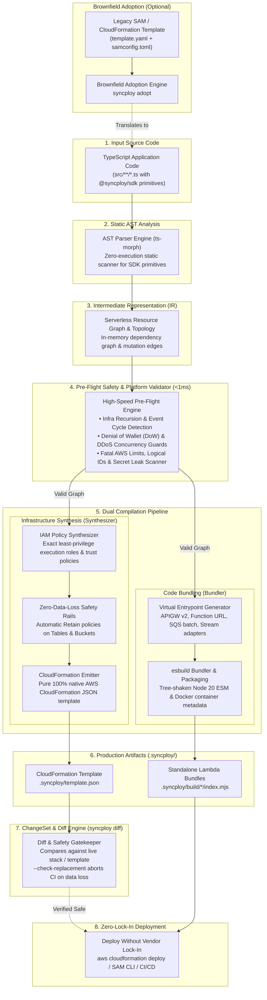

# ⚡ Syncploy

[](https://www.npmjs.com/package/@syncploy/sdk)
[](LICENSE)
[](https://github.com/harsh-vardhhan/syncploy/actions/workflows/ci.yml)

> **Infrastructure-from-Code (IfC) Compiler for Pure AWS Serverless.**  
> Write idiomatic TypeScript. Deploy to AWS without writing YAML, Terraform, or manual IAM policies.

---

## 📦 Installation

Install the runtime SDK into your application:

```bash
bun add @syncploy/sdk
# or
npm install @syncploy/sdk
```

---

## 🎯 What is Syncploy?

Syncploy is a static compiler and SDK that analyzes your TypeScript backend code, infers the serverless infrastructure graph, synthesizes least-privilege IAM policies, and generates production-ready AWS CloudFormation templates and tree-shaken Lambda bundles.

### The Problem It Solves
Traditional AWS serverless development forces developers to maintain massive, brittle YAML templates (SAM / Serverless Framework) or imperative CDK scripts, alongside handwritten IAM policies and manual `.env` plumbing.

### The Syncploy Difference
Unlike traditional frameworks (or Encore), Syncploy is designed specifically for **Pure AWS Serverless** and **AI Coding Agents**:
1. **In-Code Resource Configuration**: Operational limits (`timeout`, `memory`, `concurrency`, `stream`, `indexes`, `cors`) are declared directly in TypeScript code—giving AI agents and developers complete system context in one place without external dashboards or consoles.
2. **Dual Ingress Options**: Supports both **API Gateway (HTTP API v2)** for unified REST routing and **Lambda Function URLs** for $0 cost, native response streaming, and up to 15-minute timeouts (essential for AI/LLM workloads).
3. **Pure Static AST Analysis**: Application code is never executed during compilation. Your source code is never mutated. The compiler outputs production-ready CloudFormation and standalone `.mjs` Lambda bundles into `.syncploy/`.
4. **Zero-Data-Loss Safety Rails**: DynamoDB tables and S3 buckets are protected with automatic `Retain` policies, and pre-flight gatekeepers block destructive replacements before CloudFormation runs.

---

## 🏗️ Compiler Architecture & Workflow



---

## ☁️ Supported Pure AWS Serverless Services

Syncploy targets services that **scale to zero**, require **zero VPC/server management**, and authenticate over stateless IAM/HTTPS:

| Service Category | AWS Service | Syncploy SDK Primitive | In-Code Configuration |
| :--- | :--- | :--- | :--- |
| **Compute** | **AWS Lambda** (Node 20 ESM & Docker Containers) | `api(...)`, `queue.consumer(...)`, `table.stream(...)`, `topic.subscribe(...)` | `memory`, `timeout`, `concurrency`, `container` (`dockerfile`, `context`, `imageUri`, `cmd`, `entrypoint`) |
| **HTTP Ingress (Unified)** | **API Gateway (HTTP API v2)** | `api({ ingress: "api-gateway" })` | `path`, `method`, `auth`, `cors` |
| **Direct Ingress (Streaming)** | **Lambda Function URLs** | `api({ ingress: "function-url" })` | `timeout` up to 15m, native response streaming, $0 cost |
| **NoSQL Database** | **Amazon DynamoDB (On-Demand)** | `new Table("name", { ... })` | `partitionKey`, `sortKey`, `indexes` (GSIs), `stream`, `pointInTimeRecovery`, `retain` |
| **Database Streams** | **Amazon DynamoDB Streams** | `table.stream(...)` | `batchSize`, `startingPosition`, `enabled`, partial batch failure reporting |
| **Object Storage** | **Amazon S3** | `new Bucket("name", { ... })` | `versioned`, `eventBridge`, `publicAccessBlock`, `objectLock` (COMPLIANCE/GOVERNANCE), `retain` |
| **Data Streaming** | **Amazon Data Firehose** | `new DeliveryStream("name", { ... })` | `destination`, `bufferingInterval`, `bufferingSize`, `compression`, `prefix`, `errorPrefix` |
| **Message Queues** | **Amazon SQS** | `new Queue("name", { ... })` | `visibilityTimeout`, `deadLetterQueue` (auto-DLQ generation), `fifo` |
| **Pub/Sub Messaging** | **Amazon SNS** | `new Topic("name", { ... })`, `topic.subscribe(...)` | `fifo`, IAM subscriptions |
| **Monitoring & Alarms** | **Amazon CloudWatch** | `new Alarm("name", { ... })` | `threshold`, `evaluationPeriods`, `comparison`, `metrics`, `alarmActions` (SNS topics) |
| **Event Routing** | **Amazon EventBridge** | `bucket.on("objectCreated", queue)` | Event pattern filters, S3 prefix/suffix routing |
| **Secrets & Config** | **AWS Secrets Manager / SSM** | `new Secret("KEY")` | Type-safe environment injection |
| **Access Control** | **AWS IAM** | *Automatic* | Static inference generates exact least-privilege policies |

---

## 💻 Code Example: In-Code Infrastructure Definition

```typescript
import { api, Table, Bucket, Queue, Topic, Alarm, DeliveryStream } from "@syncploy/sdk";

// 1. Single-Table DynamoDB with Stream & Secondary Indexes
export const ehrTable = new Table("ehr", {
  logicalId: "EhrTable",
  partitionKey: { name: "PK", type: "string" },
  sortKey: { name: "SK", type: "string" },
  billingMode: "PAY_PER_REQUEST",
  stream: "NEW_IMAGE",
  pointInTimeRecovery: true,
  indexes: {
    SKIndex: { partitionKey: "SK", sortKey: "PK", projection: "ALL" },
    GSI1Index: { partitionKey: "GSI1PK", sortKey: "GSI1SK", projection: "ALL" },
  },
});

// 2. S3 Bucket with EventBridge Notification Routing
export const documentsBucket = new Bucket("documents", {
  logicalId: "DocumentsBucket",
  versioned: true,
  eventBridge: true,
  publicAccessBlock: true,
});

// 3. SQS Queue with auto-generated Dead Letter Queue (DLQ)
export const annotationQueue = new Queue("annotations", {
  logicalId: "AnnotationQueue",
  visibilityTimeout: "180s",
  deadLetterQueue: {
    maxReceiveCount: 3,
  },
});

// 4. REST API Endpoint (API Gateway v2) with Concurrency & CORS
export const getDocument = api(
  {
    method: "GET",
    path: "/documents/:id",
    timeout: "30s",
    memory: "256MB",
    concurrency: 2, // Caps parallel instances to prevent runaway costs
    cors: {
      allowOrigins: ["https://myfrontend.vercel.app"],
      allowHeaders: ["Content-Type", "Authorization"],
    },
  },
  async ({ id }: { id: string }) => {
    return await ehrTable.get({ PK: `DOC#${id}`, SK: "METADATA" });
  }
);

// 5. Long-Running LLM Analysis Endpoint via Lambda Function URL
export const analyzeClinicalDoc = api(
  {
    method: "POST",
    path: "/analyze",
    ingress: "function-url", // Direct HTTPS URL: bypasses API Gateway's 30s limit
    timeout: "300s",         // 5 minutes for heavy processing
    memory: "1024MB",
  },
  async ({ docId }: { docId: string }) => {
    const text = await documentsBucket.getText(`documents/${docId}.txt`);
    return { docId, analyzed: true };
  }
);

// 6. Queue Worker with Partial Batch Failure Reporting
export const processAnnotation = annotationQueue.consumer(
  {
    batchSize: 5,
    timeout: "120s",
    concurrency: 2,
    policies: [
      {
        actions: ["sagemaker:InvokeEndpoint"],
        resources: ["*"],
      },
    ],
  },
  async (event) => {
    console.log("Processing clinical document:", event);
  }
);
```

---

## 🛡️ Pre-Flight AWS Platform Validator (<1ms)

Syncploy includes a high-speed static validator that catches fatal AWS platform constraints, recursive infrastructure loops, and Denial-of-Wallet (DoW) risks during compilation in **< 1 millisecond**—long before CloudFormation is ever invoked:

* **Infra Recursion & Cycle Detection (Fatal)**: Traces directed event and mutation graphs using DFS cycle detection to catch infinite self-amplifying loops (`Table -> Stream -> Table.put`, `Queue -> Consumer -> Queue.send`, `Bucket -> EventBridge -> Queue -> Consumer -> Bucket.upload`) that cause exponential invocations.
* **Denial of Wallet (DoW) & DDoS Guards**:
  * **SQS Timeout Mismatch**: Enforces that queue `visibilityTimeout` is greater than consumer `timeout`. Catches runaway duplicate concurrent executions caused by SQS redelivering in-flight messages prematurely.
  * **Missing DLQ / Retry Storms**: Warns when active queue consumers lack a `deadLetterQueue`, preventing poison pill messages from retrying continuously for up to 14 days.
  * **Uncapped Public Concurrency**: Warns when public endpoints or Function URLs lack `concurrency` caps, preventing DDoS attacks from horizontally scaling Lambdas to account limits (1,000+ parallel instances).
  * **DynamoDB Shard Surge Guard**: Warns on unthrottled stream consumers without `concurrency` limits to prevent shard-split cost spikes.
* **CloudFormation Logical IDs**: Strictly alphanumeric (`^[A-Za-z0-9]+$`). Catches fatal syntax errors like `logicalId: "ehr-table"`.
* **Lambda Limits**: Validates memory (128 MB to 10,240 MB integer) and timeout limits (1s to 900s / 15m). Catches illegal sizes like `64MB` or `20m`.
* **S3 Bucket Naming**: Enforces strict RFC 1123 DNS compliance (lowercase only, no underscores, no consecutive dots, 3–63 chars).
* **FIFO Messaging**: Enforces the mandatory `.fifo` suffix on all FIFO queues and topics.
* **DynamoDB Schema**: Catches primary key and sort key attribute collisions and enforces the 20 GSI hard limit.
* **Firehose Boundaries**: Validates buffering intervals (60s to 900s) and buffer sizes (1 MB to 128 MB).
* **CORS Protocol Validation**: Detects origins missing protocol schemes (e.g. catches `localhost:3000` and instructs `http://localhost:3000`).
* **IAM Policy Validation**: Enforces `service:Action` format and warns on overly permissive `*` / `*` wildcards.
* **Secret Leak Scanner**: Detects committed plaintext API keys and secrets in environment variables (`sk-proj-...`, `AKIA...`, `ghp_...`, PEM private keys).

---

## 🔒 Zero-Data-Loss Safety Rails

In standard CloudFormation, changing an immutable property (like a DynamoDB table name or S3 bucket name) causes CloudFormation to **destroy the old resource and delete all your data**.

Syncploy prevents this with two built-in safety rails:

1. **Automatic `Retain` Policies**:
   Every `Table` and `Bucket` synthesized by Syncploy automatically receives:
   ```json
   "DeletionPolicy": "Retain",
   "UpdateReplacePolicy": "Retain"
   ```
   Even if an engineer makes a naming mistake, **AWS is physically prohibited from deleting the database or bucket**. (Opt out for ephemeral test resources using `retain: false`).

2. **Pre-Flight Replacement Gatekeeper**:
   Running `syncploy diff --check-replacement` automatically detects if any stateful resource would be replaced. If detected, **it immediately aborts with an exit code 1**, protecting production CI/CD pipelines from catastrophic data loss.

---

## 🔍 ChangeSet & Diff Engine (`syncploy diff`)

Syncploy features a Terraform-like diff engine that compares your synthesized infrastructure against an existing SAM/CloudFormation template or a live deployed AWS stack:

```bash
# Diff against a local template file
syncploy diff --against template.yaml

# Diff against a live AWS CloudFormation stack (creates a temporary ChangeSet)
syncploy diff --stack-name my-production-stack

# Enforce safety gatekeeper in CI/CD (aborts if stateful resources would be replaced)
syncploy diff --against template.yaml --check-replacement
```

### Visual Diff Output:
```text
Infrastructure Diff Preview:

  ~ [UPDATE] EhrBackendFunction (AWS::Serverless::Function -> AWS::Lambda::Function)
      • Migrated from Serverless macro to pure CloudFormation function
  ~ [UPDATE] EhrAnnotationQueue (AWS::SQS::Queue)
      • ~ VisibilityTimeout (120 -> 180)
  ! [REPLACE] EhrTable (AWS::DynamoDB::Table)
      ⚠ DANGER: Resource will be DESTROYED and RECREATED!
      • TableName changed ("prod-ehr-table" -> "my-stack-ehr")

Diff Summary:
  + 0 to create | ~ 2 to update | ! 1 to replace | - 0 to delete | 5 unchanged
```

---

## 🔄 Brownfield Adoption (`syncploy adopt`)

Migrate existing AWS SAM or CloudFormation projects to Syncploy in seconds:

```bash
# Adopt a SAM template, resolving parameters from samconfig.toml
syncploy adopt ./template.yaml --config ./samconfig.toml --out src/infra.ts

# Or pass parameter overrides directly
syncploy adopt ./template.yaml --params EhrTableName=prod-ehr-table --out src/infra.ts
```

The adopt engine parses the template, resolves physical names and parameters, and outputs idiomatic TypeScript with exact `logicalId`s, primary keys, GSIs, streams, DLQs, and alarms preserved.

---

## 🚀 Compiler CLI Reference

```text
Usage: syncploy [command] [options]

Commands:
  build [dir]                  Compile TypeScript backend into CloudFormation and Lambda bundles
  diff [dir] [options]         Compare synthesized infrastructure against a template or live AWS stack
  adopt <template> [options]   Automatically adopt an existing SAM/CloudFormation template into TypeScript

Diff Options:
  -a, --against <file>         Existing template file to diff against (e.g. template.yaml)
  -s, --stack-name <name>      AWS CloudFormation stack name for live ChangeSet diff
  --region <region>            AWS region for live ChangeSet diff
  --check-replacement          Abort and exit with error if any stateful resource would be replaced
  --allow-stateful-replacement Bypass the replacement safety check

Adopt Options:
  -c, --config <samconfig>     Path to samconfig.toml to extract parameter overrides
  -o, --out <file>             Output TypeScript file path (e.g. src/infra.ts)
  -p, --params <params...>     Inline parameter overrides (Key=Value)
```

### Deploying the Compiled Artifacts

Syncploy emits standard AWS CloudFormation and standalone Lambda bundles into `.syncploy/`, allowing deployment via AWS CLI, SAM, or CI/CD without vendor lock-in:

```bash
# Using standard AWS CLI
aws cloudformation deploy \
  --template-file .syncploy/template.json \
  --stack-name my-serverless-app \
  --capabilities CAPABILITY_IAM CAPABILITY_NAMED_IAM

# Or using AWS SAM
sam deploy --template-file .syncploy/template.json
```
